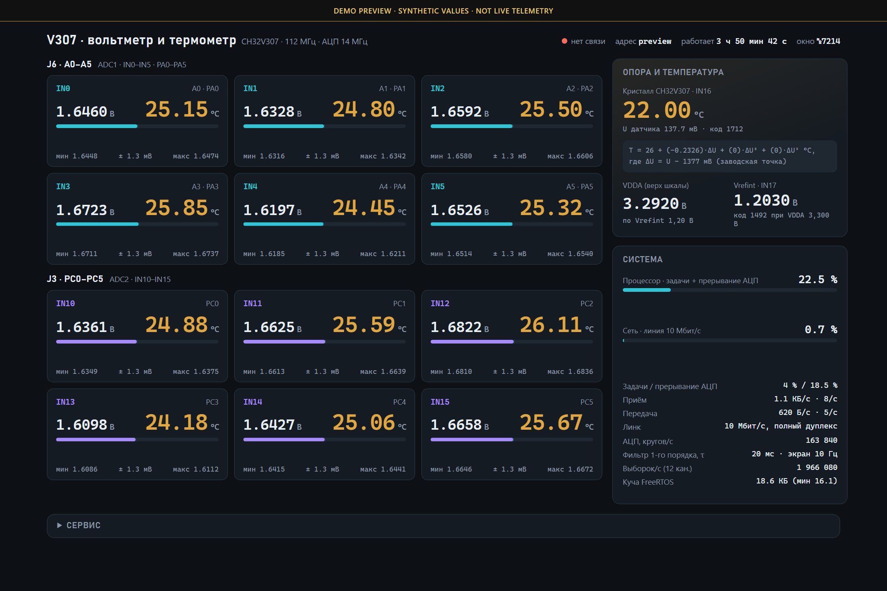
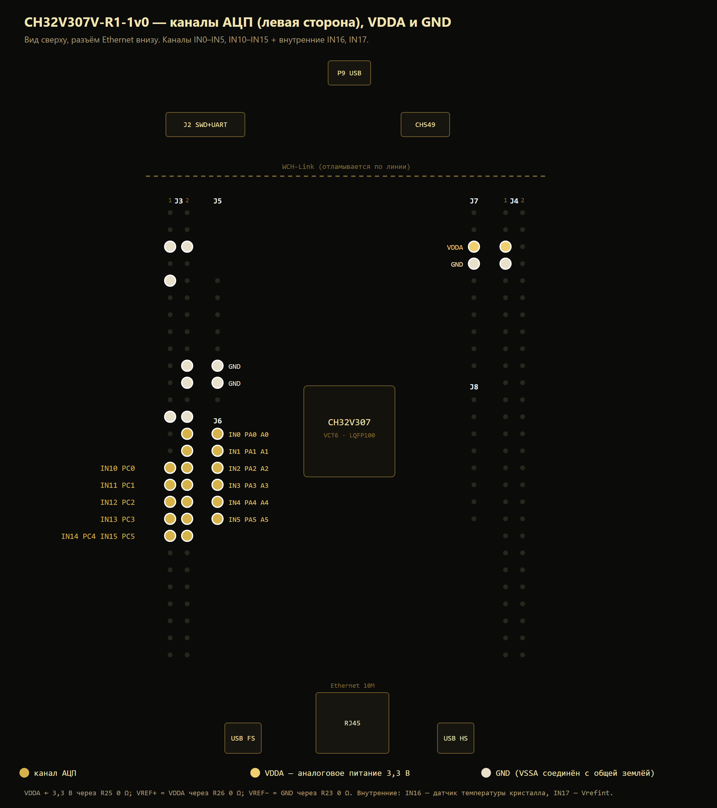
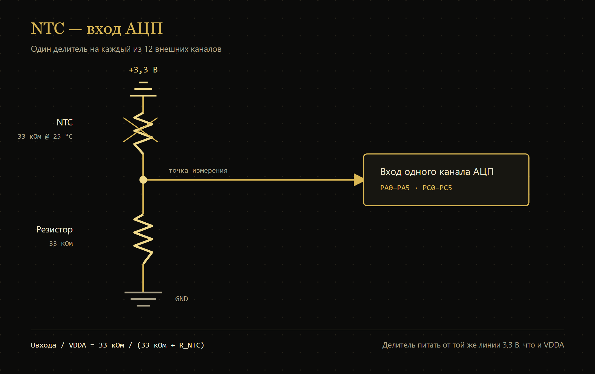

# V307_FreeRTOS

**Вольтметр на 12 входов и NTC-термометр по Ethernet** для оценочной платы
`CH32V307V-R1-1v0`: FreeRTOS 11.1.0, lwIP 2.2.1, CMake, Ninja и WCH RISC-V GCC 15.

Прошивка запускает АЦП1 и АЦП2 параллельно, корректирует шкалу по внутреннему
Vrefint, вычисляет температуру подключённых NTC и отдаёт данные в локальную
веб-панель с частотой 10 Гц. Адрес получает от DHCP-роутера; встроенного DHCP-
сервера в проекте нет.

[English](README_EN.md) · [中文](README_ZH.md) · [Сборка](docs/BUILDING.md) · [Датчики и распиновка](docs/THERMISTORS.md)



*Веб-панель проекта. Данные на изображении демонстрационные; живая плата была недоступна при подготовке снимка.*

## Проект в двух словах

| Узел | Реализация |
|---|---|
| Плата | WCH `CH32V307V-R1-1v0`, MCU `CH32V307VCT6` |
| Ядро | QingKe V4F, RISC-V, 112 МГц |
| Память | 192 КБ Flash + 128 КБ RAM |
| Аналоговые входы | 12 внешних: ADC1 `PA0–PA5` и ADC2 `PC0–PC5` |
| Внутренние каналы | IN16 — температура кристалла; IN17 — Vrefint для оценки VDDA |
| Сеть | Встроенный 10BASE-T PHY, DHCP-клиент, HTTP, mDNS и NetBIOS |
| Интерфейс | Встроенная в прошивку страница, `/api/meas`, опрос 10 Гц |
| Инструменты | Windows, CMake ≥ 3.20, Ninja, WCH GCC 15 и OpenOCD из MounRiver Studio 2 |

```bat
build.bat          :: собрать ELF, HEX и BIN в obj\
build.bat clean    :: удалить каталог сборки
build.bat flash    :: собрать, записать HEX через WCH-Link и проверить
```

Для чистой Windows-машины, установки инструментов, переменных среды и сборки в
MounRiver Studio см. [подробную инструкцию](docs/BUILDING.md). Команда `flash`
изменяет содержимое подключённого микроконтроллера.

## Подключение

1. Подайте питание и подключите отладку кабелем USB-C к разъёму P9 со встроенным
   WCH-Link.
2. Подключите RJ45 платы к локальной сети, в которой работает DHCP-роутер.
3. Подключите компьютер к той же сети. Откройте `http://v307.local` или
   `http://v307`; если mDNS/NetBIOS не разрешается, используйте адрес из DHCP-
   списка роутера.
4. Подключите датчики к входам согласно [схеме NTC и таблице контактов](docs/THERMISTORS.md).



## Что делает прошивка

- Одновременное сканирование 12 каналов двумя АЦП и кольцевым DMA.
- Фильтр первого порядка с `τ ≈ 20 мс`; публикация окна измерений каждые 50 мс.
- Пересчёт каналов в вольты по VDDA, оцениваемому через внутренний Vrefint.
- Пересчёт каждого внешнего входа в температуру NTC `Murata NCP18WB333J03RB`.
- Оценка температуры кристалла по заводской точке калибровки IN16.
- Веб-панель показывает напряжение, температуру, минимум/максимум за окно,
  состояние сети, нагрузку CPU и свободную кучу FreeRTOS.
- Встроенный HTTP-сервер выдаёт `/api/meas`; страница обновляет её 10 раз в секунду.
- lwIP предоставляет DHCP-клиент, mDNS (`v307.local`) и NetBIOS (`v307`).

Текущая прошивка трактует все 12 внешних входов как термисторные делители. Если
подать на канал произвольный аналоговый сигнал, напряжение останется измеряемым,
но показание температуры для него не имеет смысла.

## Подключение термодатчика

На каждый канал нужен NTC `NCP18WB333J03RB` (33 кОм при 25 °C, B25/85 = 4108 K)
и постоянный резистор 33 кОм. NTC подключается к +3,3 В, постоянный резистор — к
GND, а точка между ними — к одному входу АЦП. Питание делителя должно быть тем же
3,3-вольтовым питанием, что и VDDA: прошивка вычисляет температуру по отношению
`Uвх / VDDA`.



Подробности, назначение всех 12 входов, рекомендуемый конденсатор и ограничения
по входному напряжению собраны в [руководстве по датчикам](docs/THERMISTORS.md).

## Состояние и ограничения

На плате проверены загрузка по Ethernet, DHCP-клиент и веб-панель. Запись
измерений 25 ноября зафиксировала работу сканирования до 163 840 кругов/с
(1,97 млн выборок/с по 12 каналам) и загрузку прерывания АЦП около 18,5%.
Показания реальных датчиков и точность каналов под известным напряжением ещё
нужно проверить на собранном делителе и эталонном мультиметре.

Для максимальной скорости АЦП используется время выборки 1,5 такта. Источник
должен иметь низкое выходное сопротивление; для термисторного делителя рядом с
входом рекомендуется конденсатор 10–100 нФ на GND. Ethernet работает на 112 МГц;
частоту MDC и устойчивость связи следует учитывать при переносе прошивки на
другую ревизию платы.

## Исходный код и лицензии

Прикладной код проекта распространяется по [0BSD](LICENSE). Сторонние компоненты
сохраняют собственные лицензии и условия: FreeRTOS — MIT, lwIP — BSD-3-Clause,
библиотека периферии и EVT-файлы WCH — только для микроконтроллеров WCH. Полный
перечень см. в [LICENSE](LICENSE) и заголовках исходных файлов.

## Поисковые теги

`#CH32V307` `#CH32V307VCT6` `#CH32V307V-R1-1v0` `#WCH` `#QingKeV4F`
`#RISC-V` `#FreeRTOS` `#lwIP` `#Ethernet` `#ADC` `#NTC` `#NCP18WB333J03RB`
`#MounRiver` `#CMake` `#Ninja` `#WCHLink`

GitHub Topics этого репозитория дополнительно индексируют плату, MCU и стек:
`ch32v307`, `ch32v307vct6`, `ch32v307v-r1`, `wch`, `qingke`, `riscv`,
`freertos`, `lwip`, `ethernet`, `adc`, `ntc`, `embedded-systems`.

---

Автор: [mamkincoderr](https://github.com/mamkincoderr)
