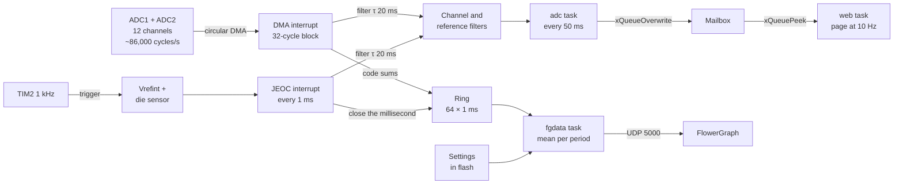

# V307_FreeRTOS

[](https://hits.sh/github.com/mamkincoderr/V307_FreeRTOS/)
[](https://github.com/mamkincoderr/V307_FreeRTOS/stargazers)
[](https://github.com/mamkincoderr/V307_FreeRTOS/network/members)
[](https://github.com/mamkincoderr/V307_FreeRTOS/commits/main)
[](https://github.com/mamkincoderr/V307_FreeRTOS)
[](LICENSE)
-A2191F)


**A 12-channel voltmeter and NTC thermometer over Ethernet** for the WCH
`CH32V307V-R1-1v0` evaluation board. The firmware uses FreeRTOS 11.1.0, lwIP
2.2.1, CMake, Ninja, and WCH RISC-V GCC 15.

ADC1 and ADC2 scan 12 analog inputs in parallel. The firmware corrects voltage
using the internal Vrefint reading, converts each external input to an NTC
temperature, serves a local web dashboard at 10 Hz, and streams all 12 channels to
[FlowerGraph](https://github.com/mamkincoderr/FlowerGraph) at up to 1 kHz. Network settings come
from the router's DHCP server; this project does not run a DHCP server.

[Русская версия](README.md) · [中文](README_ZH.md) · [Detailed build guide](docs/BUILDING.md) ·
[Thermistor wiring and pinout](docs/THERMISTORS.md) · [FlowerGraph (RU)](docs/FLOWERGRAPH.md)


*Captured from the live board on 25 November 2026. The inputs are not connected to sensors yet, so the values are pickup noise.*

## Hardware and software

| Item | Configuration |
|---|---|
| Board / MCU | WCH `CH32V307V-R1-1v0` / `CH32V307VCT6` |
| Core | QingKe V4F, RISC-V, 112 MHz |
| Memory | 192 KB Flash + 128 KB RAM |
| External ADC | 12 inputs: ADC1 `PA0–PA5`, ADC2 `PC0–PC5` |
| Internal ADC | IN16: die temperature; IN17: Vrefint for VDDA estimation |
| Network | On-board 10BASE-T PHY, DHCP client, HTTP, mDNS, NetBIOS |
| Telemetry | FG-NET for FlowerGraph: 12 channels at 1000 / 100 / 10 / 1 Hz, mV or °C per channel |
| Build tools | Windows, CMake ≥ 3.20, Ninja, WCH GCC 15 and OpenOCD from MounRiver Studio 2 |

## Build

```bat
build.bat          :: build ELF, HEX and BIN under obj\
build.bat clean    :: remove the build directory
build.bat flash    :: build, program through WCH-Link and verify
```

The build script locates GCC 15 and OpenOCD in a standard MounRiver Studio 2
installation. For a non-standard installation, set `WCH_TOOLCHAIN_DIR` to the
compiler's `bin` directory and `WCH_OPENOCD_DIR` to the OpenOCD `bin` directory.
See the [step-by-step Windows build guide](docs/BUILDING.md) for installation,
troubleshooting, and MounRiver Studio integration. `flash` writes to the
connected MCU.

## Thermistor wiring

Each input uses one `Murata NCP18WB333J03RB` NTC (33 kΩ at 25 °C, B25/85 = 4108 K)
and one 33 kΩ fixed resistor. Connect the NTC to +3.3 V, the fixed resistor to
GND, and the junction to one ADC input. Power the divider from the same 3.3 V rail
as VDDA; temperature is calculated from the ratio `Vinput / VDDA`.


The [thermistor guide](docs/THERMISTORS.md) lists all 12 connector pins, the
divider equation, ADC acquisition-time guidance, and input-voltage limits.

## What the firmware does

- Scans 12 channels with two ADCs and circular DMA, about 86,000 scan cycles/s at a 13.5-cycle acquisition time.
- Measures Vrefint and the die temperature with the injected group, triggered by TIM2 1,000 times per second.
- Applies a first-order filter with `τ ≈ 20 ms`; publishes a measurement window
  every 50 ms.
- Converts raw readings to volts using VDDA estimated from internal Vrefint.
- Converts each external channel to the temperature of the supported NTC.
- Estimates MCU die temperature from the factory calibration point on IN16.
- Serves a built-in web page and JSON endpoint at `/api/meas`.
- Uses lwIP for DHCP client, mDNS (`v307.local`), and NetBIOS (`v307`).
- Streams to FlowerGraph over FG-NET; rate and per-channel units are set on the page and stored in flash.

The current firmware interprets all 12 external inputs as thermistor dividers.
For a general analog signal, the voltage reading is still meaningful, but the
temperature shown for that channel is not.

## FlowerGraph

The board streams 12 channels to [FlowerGraph](https://github.com/mamkincoderr/FlowerGraph) over FG-NET
without any change to FlowerGraph: it reads the channels, units and rate from the schema the board sends.
The "Настройки FlowerGraph" (FlowerGraph settings) section of the page selects the output rate
(1000 / 100 / 10 / 1 Hz) and mV or °C for each channel. Each sample is the mean of all conversions in its
period. In FlowerGraph, choose the FG-NET source, pick `V307 XXXXXX`, and press Start; press Start again
after saving new settings.


Settings live in flash and survive reset and power-off. Programming through WCH-Link erases the whole chip,
so set them again after reflashing. Protocol details and test results: [docs/FLOWERGRAPH.md](docs/FLOWERGRAPH.md) (Russian).

## How it works



Interrupts only accumulate: sums, minima and maxima, first-order filters, and the millisecond ring.
Conversion to volts and degrees happens in tasks. Tasks share no variables: the page gets results from a
one-item FreeRTOS queue (mailbox), FlowerGraph from the ring.

## Measurement status and limits

Ethernet, DHCP client, and the web dashboard have been checked on the board. A
25 November 2026 measurement recorded about 86,000 scan cycles/s (about 1 million
samples/s across 12 channels), about 13% CPU time in ADC interrupts and 5–7% in tasks.
The FlowerGraph stream was checked at 1000, 100 and 1 Hz with no lost packets. Known inputs:
0 V on PC0 reads 0.009 V, 3.3 V on PC1 reads 3.284 V (VDDA 3.293 V).
Voltage accuracy against a meter and temperature accuracy with physical NTCs
still need to be checked on the assembled sensor dividers.

The ADC uses a 13.5-cycle acquisition time, as in the KiloHertz stabilizers: 1.5 cycles need
a dedicated analog layout that this evaluation board does not have. A 10–100 nF capacitor from
the thermistor node to GND, close to the MCU, still helps against noise. Ethernet is clocked from a 112 MHz
system clock; check MDC frequency and link stability when moving to another
board revision.

## Licensing

Project application code is released under [0BSD](LICENSE). Third-party files
retain their own terms: FreeRTOS is MIT, lwIP is BSD-3-Clause, and WCH peripheral
library / EVT files are restricted to WCH microcontrollers. See [LICENSE](LICENSE)
and source headers for the complete file list.

## Search tags

`#CH32V307` `#CH32V307VCT6` `#CH32V307V-R1-1v0` `#WCH` `#QingKeV4F`
`#RISC-V` `#FreeRTOS` `#lwIP` `#Ethernet` `#ADC` `#NTC` `#MounRiver`
`#FlowerGraph` `#FG-NET` `#Telemetry` `#DataAcquisition` `#Voltmeter` `#Thermometer`

Author: [mamkincoderr](https://github.com/mamkincoderr)
