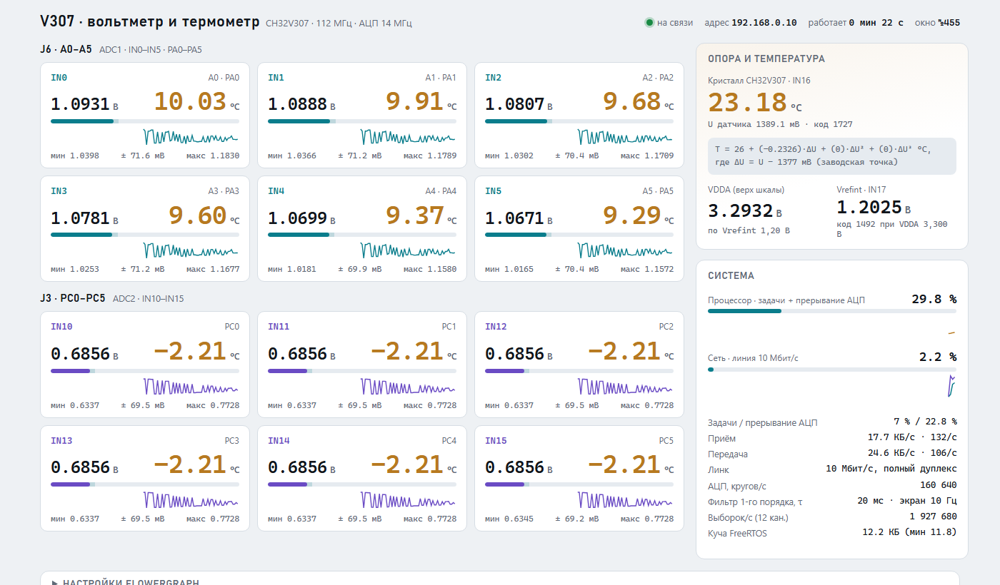
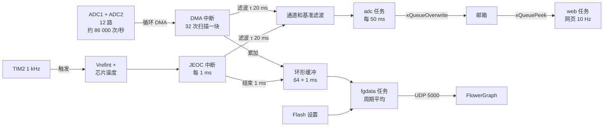

# V307_FreeRTOS

[](https://hits.sh/github.com/mamkincoderr/V307_FreeRTOS/)
[](https://github.com/mamkincoderr/V307_FreeRTOS/stargazers)
[](https://github.com/mamkincoderr/V307_FreeRTOS/network/members)
[](https://github.com/mamkincoderr/V307_FreeRTOS/commits/main)
[](https://github.com/mamkincoderr/V307_FreeRTOS)
[](LICENSE)
-A2191F)


面向 WCH `CH32V307V-R1-1v0` 开发板的 **12 通道电压表和 NTC 温度计**。
固件使用 FreeRTOS 11.1.0、lwIP 2.2.1、CMake、Ninja 和 WCH RISC-V GCC 15。

ADC1 与 ADC2 同时扫描 12 个模拟输入。固件使用内部 Vrefint 估算 VDDA，
计算 NTC 温度，以 10 Hz 更新网页，并以最高 1 kHz 将 12 路数据传给
[FlowerGraph](https://github.com/mamkincoderr/FlowerGraph)。网络地址由路由器的 DHCP 服务器分配；
本项目不运行 DHCP 服务器。

[Русский](README.md) · [English](README_EN.md) ·
[Windows 构建指南](docs/BUILDING.md) · [NTC 接线和引脚](docs/THERMISTORS.md) · [FlowerGraph（俄文）](docs/FLOWERGRAPH.md)



*2026 年 11 月 25 日开发板实时截图。输入尚未接传感器，数值为干扰。*

## 硬件与软件

| 项目 | 配置 |
|---|---|
| 开发板 / MCU | WCH `CH32V307V-R1-1v0` / `CH32V307VCT6` |
| 内核 | QingKe V4F，RISC-V，112 MHz |
| 外部 ADC 输入 | 12 路：ADC1 `PA0–PA5`，ADC2 `PC0–PC5` |
| 内部 ADC 通道 | IN16 芯片温度；IN17 Vrefint |
| 网络 | 板载 10BASE-T PHY，DHCP 客户端、HTTP、mDNS、NetBIOS |
| 遥测 | FG-NET（FlowerGraph）：12 路，1000 / 100 / 10 / 1 Hz，每路 mV 或 °C |

## 构建

需要 Windows、CMake 3.20 或更高版本、Ninja，以及 MounRiver Studio 2 提供的
WCH GCC 15 和 OpenOCD。MounRiver Studio 1.92 可选，用于 IDE 集成。

在仓库目录中运行：

```bat
build.bat          :: 编译，生成 obj\ 下的 ELF、HEX 和 BIN
build.bat clean    :: 删除构建目录
build.bat flash    :: 通过 WCH-Link 写入并校验 MCU
```

详细安装步骤和故障排查见[构建指南](docs/BUILDING.md)。`flash` 会写入连接的
微控制器。

## NTC 温度传感器

每路使用 `Murata NCP18WB333J03RB`（25 °C 时 33 kΩ，B25/85 = 4108 K）和一个
33 kΩ 固定电阻：NTC 接 +3.3 V，固定电阻接 GND，中间节点接一个 ADC 输入。
分压器必须与 VDDA 使用同一条 3.3 V 电源线。ADC 采样时间为 13.5 个周期；建议在 ADC 输入
与 GND 之间、靠近 MCU 放置 10–100 nF 电容以降低噪声。

| 通道 | MCU 输入 | 板上引脚 |
|---|---|---|
| IN0–IN5 | PA0–PA5 / ADC1 | J6.1–J6.6 |
| IN10–IN15 | PC0–PC5 / ADC2 | J3.31、33、35、37、39、40 |

输入电压必须保持在 0…VDDA 范围，不能接 5 V。当前固件把 12 路外部输入都当作
NTC 分压器处理。详细电路和限制见[传感器指南](docs/THERMISTORS.md)。

## FlowerGraph

开发板通过 FG-NET 协议向 [FlowerGraph](https://github.com/mamkincoderr/FlowerGraph) 发送 12 路数据，
FlowerGraph 无需修改：通道、单位和速率来自开发板发送的描述（schema）。在网页的
“Настройки FlowerGraph”（FlowerGraph 设置）中选择输出速率（1000 / 100 / 10 / 1 Hz）和每路的单位
（mV 或 °C）。每个样本是该周期内全部转换的平均值。在 FlowerGraph 中选择 FG-NET 数据源和
`V307 XXXXXX`，点击“开始”；保存新设置后需再次点击“开始”。


设置保存在 Flash 中，复位和断电后保留。通过 WCH-Link 烧录会擦除整个芯片，烧录后需重新设置。



## 搜索标签

`#CH32V307` `#CH32V307VCT6` `#WCH` `#QingKeV4F` `#RISC-V` `#FreeRTOS`
`#lwIP` `#Ethernet` `#ADC` `#NTC` `#MounRiver` `#FlowerGraph` `#FG-NET`
`#Telemetry` `#DataAcquisition`
