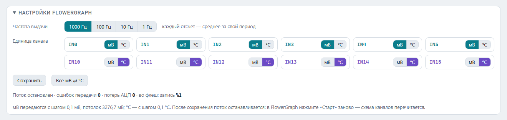
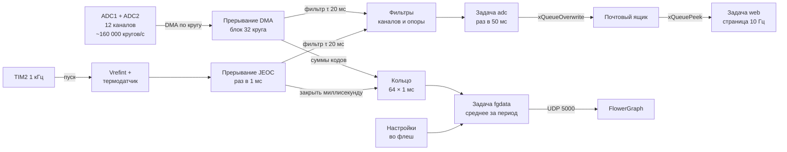
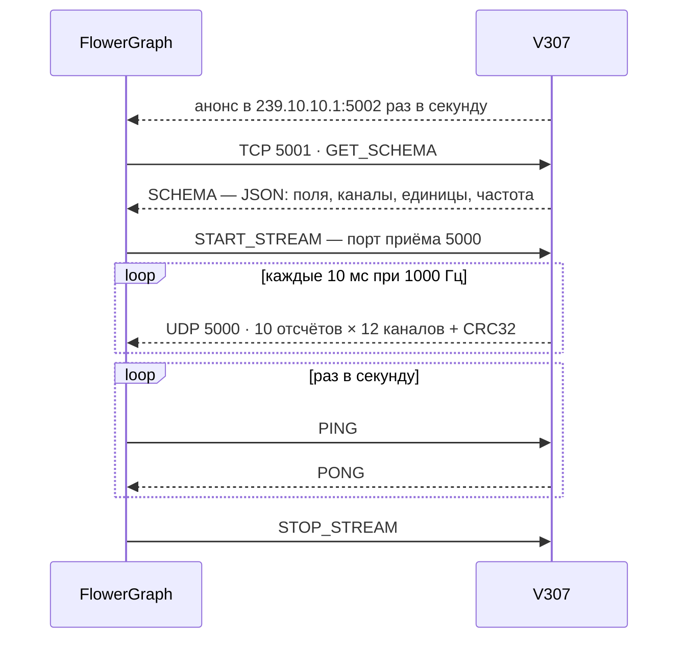

# FlowerGraph: поток измерений с платы

Плата отдаёт 12 каналов в [FlowerGraph](https://github.com/mamkincoderr/FlowerGraph) по протоколу FG-NET —
тому же, что у шлюза стабилизаторов КилоГерц. FlowerGraph менять не нужно: каналы, единицы и частоту он
узнаёт из схемы, которую присылает плата.



## Как подключить

1. Откройте страницу платы (`http://v307.local`) и разверните «Настройки FlowerGraph»
   (прямая ссылка: `http://v307.local/#fg`).
2. Выберите частоту выдачи и единицу каждого канала, нажмите «Сохранить».
3. В FlowerGraph выберите источник **FG-NET**: плата появится в списке как `V307 XXXXXX`
   (последние байты MAC). Нажмите «Старт».
4. После каждого «Сохранить» плата останавливает поток. Нажмите в FlowerGraph «Старт» заново —
   он перечитает схему с новыми каналами.

Компьютер и плата должны быть в одной сети. Поиск идёт multicast-рассылкой `239.10.10.1:5002`;
если у компьютера несколько сетевых интерфейсов, FlowerGraph должен слушать тот, что смотрит в сеть платы.

## Настройки

| Параметр | Значения | По умолчанию |
|---|---|---|
| Частота выдачи | 1000 / 100 / 10 / 1 Гц | 1000 Гц |
| Единица канала (каждый из 12) | мВ или °C | мВ |

- **Каждый отсчёт — среднее всех оцифровок за свой период**: при 1 Гц это среднее примерно 160 000 кругов АЦП
  за секунду, а не одна случайная точка.
- **мВ** — по VDDA, вычисленному через Vrefint; шаг 0,1 мВ; верх ограничен 3276,7 мВ (предел int16 при
  множителе 0,1).
- **°C** — NTC `NCP18WB333J03RB` по доле `код / 4095` (то же, что `Uвх / VDDA`); шаг 0,1 °C; ниже −41 °C
  приходит −50 (обрыв), выше +126 °C — 150 (замыкание).
- Настройки хранятся во флеш (две копии с CRC32) и переживают сброс и выключение питания.
  **Прошивка через WCH-Link стирает весь чип** — после перепрошивки настройки возвращаются к умолчанию,
  их нужно выставить заново.

HTTP-интерфейс тех же настроек:

```text
GET /api/cfg                       текущие настройки и состояние потока
GET /api/set?r=0&u=000000111111    r — частота (0 = 1000, 1 = 100, 2 = 10, 3 = 1 Гц),
                                   u — 12 знаков по каналам IN0…IN5, IN10…IN15: 0 = мВ, 1 = °C
```

## Как устроен путь данных



Таймер TIM2 задаёт ровную миллисекунду: по нему инжектированная группа меряет Vrefint и термодатчик,
а её прерывание закрывает миллисекунду в кольце. Задача `fgdata` складывает миллисекунды до периода выдачи
(1, 10, 100 или 1000 мс) и переводит среднее в мВ или °C. Страница и FlowerGraph не делят данных
между собой: странице — почтовый ящик задачи `adc`, FlowerGraph — кольцо.

## Протокол FG-NET



| Порт | Что | Подробности |
|---|---|---|
| UDP 5000 | данные | заголовок 28 Б (`FGNT`, номер, время), тело, CRC32 как `zlib.crc32` |
| TCP 5001 | управление | кадры `CMD, LEN(LE), данные`: PING/PONG, GET_STATUS, GET_SCHEMA, START/STOP_STREAM |
| UDP 5002 | поиск | анонс с именем платы и CRC схемы; ответ на запрос поиска |

Тело пакета (профиль `STRUCTURED_V1`):

| Блок | Содержимое |
|---|---|
| `sys`, 32 Б | VDDA, Vrefint, T кристалла (float); кругов АЦП/с, прерывания АЦП ‰, CPU %, частота выдачи, потери кольца (uint32) |
| `scope` | 1 байт N, затем 12 каналов по N отсчётов int16 ×0,1: N = 10 при 1000 Гц, иначе 1 |

Пакет при 1000 Гц — 305 Б, 100 пакетов в секунду (~0,25 Мбит/с, ~2 % линии 10 Мбит/с).
Без PING 6 с поток останавливается; без единого байта 15 с соединение управления закрывается.

## Проверено на плате (25.11.2026)

Пакеты разбирались парсером самого FlowerGraph (`plugins/fg_net_source.py`):

| Частота | Пакетов | Ошибок CRC / пропусков номеров / потерь кольца |
|---|---|---|
| 1000 Гц, 10 с | 1000 | 0 / 0 / 0 |
| 100 Гц, 5 с | 499 | 0 / 0 / 0 |
| 1 Гц, 8 с | 8 | 0 / 0 / 0 |

Прерывания АЦП занимают ~23 % процессора, задачи — 5–7 %. FlowerGraph с окном проверен вручную.
