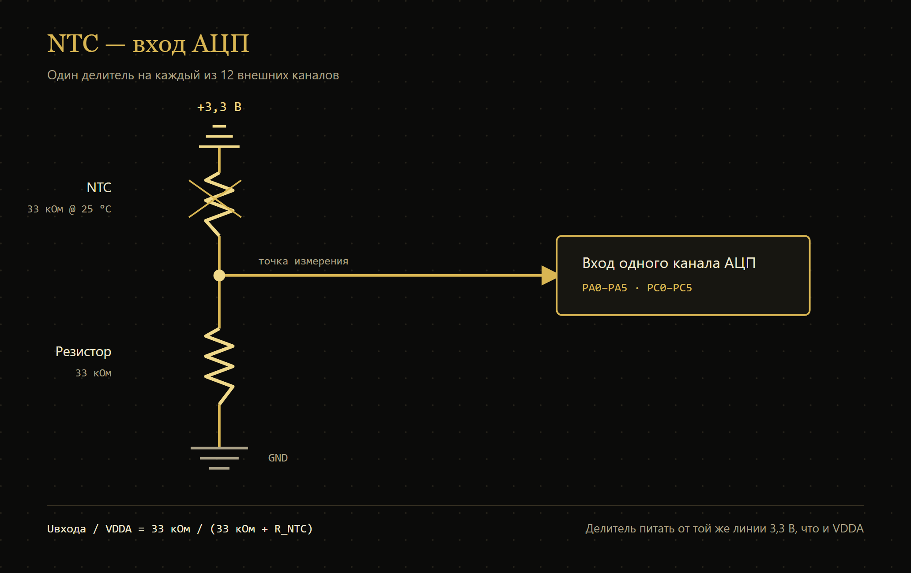

# Аналоговые входы и NTC-термометры

Прошивка измеряет 12 внешних напряжений и отображает для каждого канала
температуру термистора `Murata NCP18WB333J03RB`.

## Схема одного канала



Соберите делитель отдельно для каждого используемого входа:

1. Один вывод NTC подключите к +3,3 В.
2. Второй вывод NTC соедините с контактом входа АЦП.
3. От этого же контакта поставьте резистор **33 кОм** на GND.
4. Питайте делитель от той же линии 3,3 В, которая питает VDDA.
5. Соедините земли платы и источника сигнала.

При коротком времени выборки АЦП (1,5 такта) поставьте конденсатор 10–100 нФ
между входом АЦП и GND рядом с платой. Он даёт заряд для выборки и помогает
снизить шум. Сам источник также должен иметь низкое сопротивление.

### Типовая деталь и формула

Поддерживаемый термистор — `NCP18WB333J03RB`: 33 кОм при 25 °C, B25/85 = 4108 K.
Фиксированный нижний резистор — 33 кОм. Так как NTC подключён к питанию, а
фиксированный резистор — к земле, доля напряжения на входе равна:

```text
x = Uвхода / VDDA = 33 кОм / (33 кОм + R_NTC)
```

При 25 °C `R_NTC ≈ 33 кОм`, поэтому `x ≈ 0,5`. Использование отношения к VDDA
компенсирует изменения общего питания делителя и аналоговой части платы.

Программа использует трёхучастковую полиномиальную аппроксимацию, загруженную в
`User/adcm.c` (`ADCM_NtcTemp`). Она рассчитана для указанной модели NTC и этого
направления делителя. Для другого номинала, B-параметра или схемы делителя
аппроксимацию нужно заменить.

## Контакты платы

На плате `CH32V307V-R1-1v0` доступны 12 внешних каналов:

| Канал | АЦП / вход MCU | Контакт платы |
|---|---|---|
| IN0 | ADC1 / PA0 | J6.1 / A0 |
| IN1 | ADC1 / PA1 | J6.2 / A1 |
| IN2 | ADC1 / PA2 | J6.3 / A2 |
| IN3 | ADC1 / PA3 | J6.4 / A3 |
| IN4 | ADC1 / PA4 | J6.5 / A4 |
| IN5 | ADC1 / PA5 | J6.6 / A5 |
| IN10 | ADC2 / PC0 | J3.31 |
| IN11 | ADC2 / PC1 | J3.33 |
| IN12 | ADC2 / PC2 | J3.35 |
| IN13 | ADC2 / PC3 | J3.37 |
| IN14 | ADC2 / PC4 | J3.39 |
| IN15 | ADC2 / PC5 | J3.40 |

`VDDA` доступно на J7.3, `GND` — на J7.4. Полная карта контактов и ориентация
разъёмов показаны на [чертеже платы с подсветкой ADC, VDDA и GND](pinout_adc_free.png).

## Уровни и режим АЦП

- Напряжение на входах должно оставаться в диапазоне **0…VDDA**. Не подключайте
  к ножкам АЦП 5 В.
- Все 12 каналов сейчас интерпретируются как NTC-делители. Для обычного
  вольтметра показание температуры нужно игнорировать или изменить приложение.
- ADC1 сканирует IN0–IN5 на PA0–PA5; ADC2 одновременно сканирует IN10–IN15 на
  PC0–PC5. DMA работает по кругу.
- Внутренний IN16 — датчик температуры кристалла. IN17 — Vrefint; программа по
  нему оценивает VDDA и пересчитывает внешние напряжения.
- Для внешнего делителя используются выборка 1,5 такта, фильтр первого порядка
  около 20 мс и обновление страницы 10 раз/с.
- Температуры вне таблицы датчика отображаются как «обрыв» ниже примерно −41 °C
  и «замыкание» выше примерно +126 °C.

## Данные веб-страницы

`GET /api/meas` возвращает 12 каналов в массиве `ch`. Для каждого канала порядок
полей такой:

```text
[напряжение × 10 000, минимум × 10 000, максимум × 10 000, температура × 100]
```

В JSON температура хранится в сотых долях градуса. Внутренняя температура
кристалла и параметры Vrefint/VDDA находятся отдельно в объектах `temp` и `ref`.

## Проверка реального датчика

Состояние проекта на момент публикации: прошивка и веб-панель проверены на
плате, но показания реальных термисторов и точность напряжения ещё нужно
сверить на известных точках. Подключите известные напряжения или измерьте
собранный делитель мультиметром; сравните `Uвхода`, `VDDA` и температуру на
странице. Не оценивайте точность по снимку интерфейса: в нём демонстрационные
данные.
